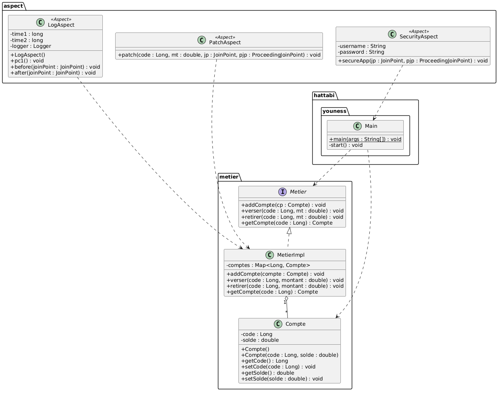
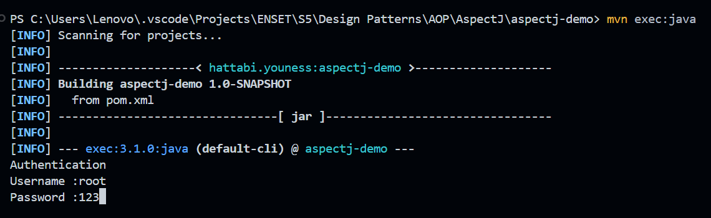
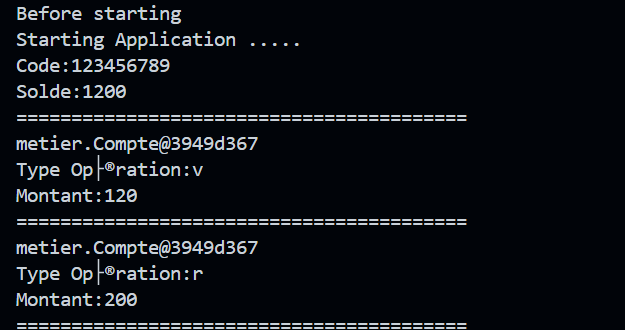
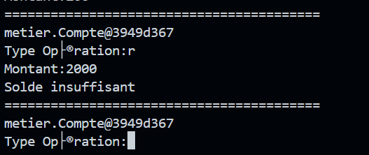
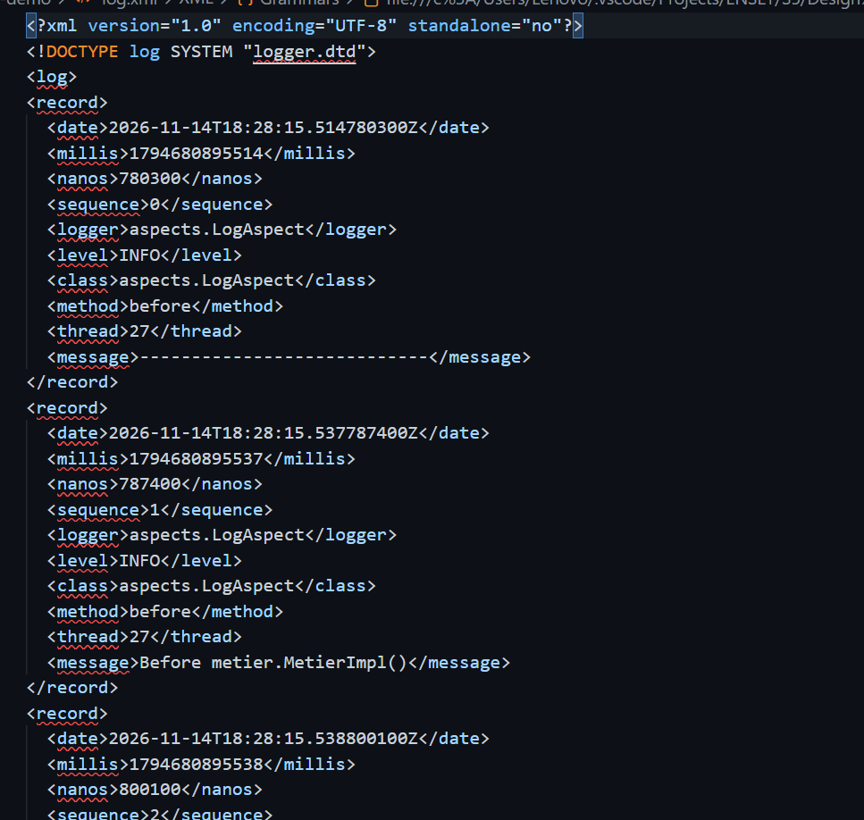

# Rapport de Travaux Pratiques : Programmation Orientée Aspect avec AspectJ

**Encadrant :** Mohamed YOUSSFI  
**Étudiant :** Youness HATTABI

---

## Table des Matières

1. [Introduction](#1-introduction)
2. [Diagramme de classes](#2-diagramme-de-classes)
3. [Implémentation](#3-implémentation)
   - 3.1 [La classe `Compte`](#31-la-classe-compte)
   - 3.2 [L'interface `Metier`](#32-linterface-metier)
   - 3.3 [La classe `MetierImpl`](#33-la-classe-metierimpl)
   - 3.4 [La classe `Main`](#34-la-classe-main)
   - 3.5 [L'aspect `LogAspect`](#35-laspect-logaspect)
   - 3.6 [L'aspect `PatchAspect`](#36-laspect-patchaspect)
   - 3.7 [L'aspect `SecurityAspect`](#37-laspect-securityaspect)
4. [Tests et Résultats](#4-tests-et-résultats)
   - 4.1 [Authentification](#41-authentification)
   - 4.2 [Exécution normale](#42-exécution-normale)
   - 4.3 [Solde insuffisant](#43-solde-insuffisant)
   - 4.4 [Fichier de log](#44-fichier-de-log)
5. [Conclusion](#5-conclusion)

---

## 1. Introduction

La **Programmation Orientée Aspect** (POA) est un paradigme qui complète la programmation orientée objet. Elle permet de séparer le code **métier** des préoccupations dites _transversales_ (journalisation, sécurité, contrôle de validité, gestion des transactions, etc.) qui, sans cela, se retrouvent dispersées et dupliquées dans toute l'application.

**AspectJ** est l'extension de référence de Java pour la POA. Ce rapport présente une application bancaire simple (gestion d'un compte, versement et retrait) sur laquelle trois aspects sont greffés **sans modifier le code métier** :

- un aspect de **journalisation** (`LogAspect`) ;
- un aspect de **vérification du solde** (`PatchAspect`) ;
- un aspect de **sécurité** par authentification (`SecurityAspect`).

Le projet est organisé comme un projet Maven, avec le package `metier` pour la couche métier, le package `aspect` pour les aspects et le package `hattabi.youness` pour la classe principale.

## 2. Diagramme de classes

**Diagramme UML :**



Lecture du diagramme :

- `MetierImpl` **implémente** l'interface `Metier` (flèche pointillée).
- `MetierImpl` **contient** une collection de `Compte` (association avec losange, attribut `comptes`).
- `Main` **utilise** `Metier` et `Compte`.
- Les trois aspects sont stéréotypés `<<Aspect>>` et sont reliés par des dépendances pointillées aux éléments qu'ils interceptent : `LogAspect` cible le package `metier`, `PatchAspect` cible `MetierImpl.retirer`, `SecurityAspect` cible `Main.start`.

**Organisation du projet :**

```
patt-aspectj/
├── pom.xml
├── log.xml                      (généré à l'exécution)
└── src/main/java/
    ├── hattabi/youness/Main.java
    ├── metier/
    │   ├── Compte.java
    │   ├── Metier.java
    │   └── MetierImpl.java
    └── aspects/
        ├── LogAspect.java
        ├── PatchAspect.java
        └── SecurityAspect.java
```

---

## 3. Implémentation

### 3.1 La classe `Compte`

Entité représentant un compte bancaire, identifié par un `code` et disposant d'un `solde`.

```java
package metier;

public class Compte {
    private Long code;
    private double solde;

    public Compte() {
    }

    public Compte(Long code, double solde) {
        this.code = code;
        this.solde = solde;
    }

    public Long getCode() {
        return code;
    }

    public void setCode(Long code) {
        this.code = code;
    }

    public double getSolde() {
        return solde;
    }

    public void setSolde(double solde) {
        this.solde = solde;
    }
}
```

---

### 3.2 L'interface `Metier`

Elle définit les opérations de la couche métier : ajout d'un compte, versement, retrait et consultation.

```java
package metier;

public interface Metier {
    void addCompte(Compte cp);

    void verser(Long code, double mt);

    void retirer(Long code, double mt);

    Compte getCompte(Long code);
}
```

---

### 3.3 La classe `MetierImpl`

Implémentation de la couche métier. Les comptes sont stockés dans une `HashMap` indexée par leur code. Cette classe **ne contient aucun code de journalisation, de sécurité ou de contrôle du solde** : ces préoccupations sont apportées par les aspects.

```java
package metier;

import java.util.HashMap;
import java.util.Map;

public class MetierImpl implements Metier {
    private Map<Long, Compte> comptes = new HashMap<>();

    @Override
    public void addCompte(Compte compte) {
        comptes.put(compte.getCode(), compte);
    }

    @Override
    public void verser(Long code, double montant) {
        Compte compte = comptes.get(code);
        compte.setSolde(compte.getSolde() + montant);
    }

    @Override
    public void retirer(Long code, double montant) {
        Compte compte = comptes.get(code);
        compte.setSolde(compte.getSolde() - montant);
    }

    @Override
    public Compte getCompte(Long code) {
        return comptes.get(code);
    }
}
```

---

### 3.4 La classe `Main`

Application console : elle crée un compte à partir du code et du solde saisis, puis propose une boucle d'opérations (`v` pour verser, `r` pour retirer, `q` pour quitter). Les exceptions (levées notamment par l'aspect `PatchAspect`) sont attrapées et leur message est affiché.

```java
package hattabi.youness;

import java.util.Scanner;

import metier.Compte;
import metier.Metier;
import metier.MetierImpl;

public class Main {
    public static void main(String[] args) {
        new Main().start();
    }

    private void start() {
        System.out.println("Starting Application .....");
        Metier metier = new MetierImpl();
        Scanner clavier = new Scanner(System.in);
        System.out.print("Code:");
        Long code = clavier.nextLong();
        System.out.print("Solde:");
        double solde = clavier.nextDouble();
        metier.addCompte(new Compte(code, solde));
        while (true) {
            try {
                System.out.println("=========================================");
                System.out.println(metier.getCompte(code).toString());

                System.out.print("Type Opération:");
                String type = clavier.next();
                if (type.equals("q"))
                    break;

                System.out.print("Montant:");
                double montant = clavier.nextDouble();
                if (type.toLowerCase().equals("v"))
                    metier.verser(code, montant);
                else if (type.toLowerCase().equals("r"))
                    metier.retirer(code, montant);

            } catch (Exception e) {
                System.out.println(e.getMessage());
            }
        }
    }
}
```

---

### 3.5 L'aspect `LogAspect`

Cet aspect trace chaque appel des méthodes du package `metier` dans le fichier `log.xml` et mesure la durée d'exécution.

- Le pointcut `pc1()` combine deux expressions : `execution(* metier.*.*(..))` (exécution de toute méthode de toute classe du package `metier`) et `initialization(metier.*.new(..))` (initialisation des objets de ce package).
- L'advice `@Before` journalise la signature et mémorise l'heure de début.
- L'advice `@After` journalise la signature et la **durée** (`time2 - time1`).
- Le `Logger` utilise un `FileHandler("log.xml")` et `setUseParentHandlers(false)` désactive l'affichage dans la console.

```java
package aspects;

import java.io.IOException;
import java.util.logging.FileHandler;
import java.util.logging.Logger;

import org.aspectj.lang.JoinPoint;
import org.aspectj.lang.annotation.After;
import org.aspectj.lang.annotation.Aspect;
import org.aspectj.lang.annotation.Before;
import org.aspectj.lang.annotation.Pointcut;

@Aspect
public class LogAspect {
    private long time1, time2;
    private Logger logger = Logger.getLogger(this.getClass().getName());

    public LogAspect() throws IOException {
        logger.addHandler(new FileHandler("log.xml"));
        logger.setUseParentHandlers(false);
    }

    @Pointcut("execution(* metier.*.*(..))||initialization(metier.*.new(..)) ")
    public void pc1() {
    }

    @Before("pc1()")
    public void before(JoinPoint joinPoint) {
        logger.info("----------------------------");
        time1 = System.currentTimeMillis();
        logger.info("Before " + joinPoint.getSignature());
    }

    @After("pc1()")
    public void after(JoinPoint joinPoint) {
        time2 = System.currentTimeMillis();
        logger.info("After " + joinPoint.getSignature());
        logger.info("Duration:" + (time2 - time1));
        logger.info("********************************");
    }
}
```

---

### 3.6 L'aspect `PatchAspect`

Cet aspect corrige le comportement de `retirer` **sans toucher à `MetierImpl`** : il empêche un retrait lorsque le solde est insuffisant.

- Le pointcut `execution(* metier.MetierImpl.retirer(..)) && args(code, mt)` cible uniquement la méthode `retirer` et récupère ses arguments.
- L'advice `@Around` récupère l'objet cible via `joinPoint.getTarget()`, consulte le solde du compte, puis :
  - appelle `proceed()` (donc exécute le vrai `retirer`) si le solde est supérieur au montant ;
  - sinon lève une `RuntimeException("Solde insuffisant")`, que `Main` attrape et affiche.

```java
package aspects;

import org.aspectj.lang.JoinPoint;
import org.aspectj.lang.ProceedingJoinPoint;
import org.aspectj.lang.annotation.Around;
import org.aspectj.lang.annotation.Aspect;

import metier.Compte;
import metier.MetierImpl;

@Aspect
public class PatchAspect {
    @Around("execution(* metier.MetierImpl.retirer(..))&&args(code,mt)")
    public void patch(Long code, double mt, JoinPoint joinPoint, ProceedingJoinPoint proceedingJoinPoint)
            throws Throwable {

        MetierImpl metier = (MetierImpl) joinPoint.getTarget();
        Compte cp = metier.getCompte(code);
        if (cp.getSolde() > mt) {
            proceedingJoinPoint.proceed();
        } else
            throw new RuntimeException("Solde insuffisant");

    }
}
```

---

### 3.7 L'aspect `SecurityAspect`

Cet aspect protège **toute l'application** : il intercepte l'appel de la méthode `start` et demande un nom d'utilisateur et un mot de passe avant de la laisser s'exécuter.

- Le pointcut `call(* *.*.*.start(..))` cible l'**appel** (et non l'exécution) de la méthode `start` d'une classe située dans un package à deux niveaux, ici `hattabi.youness.Main`.
- Si les identifiants saisis (`root` / `123`) sont corrects, l'aspect affiche « Before starting », appelle `proceed()` (qui lance l'application), puis affiche « End of Application ».
- Sinon, il affiche « Access denied ... » et l'application **n'est jamais démarrée**.

```java
package aspects;

import java.util.Scanner;

import org.aspectj.lang.JoinPoint;
import org.aspectj.lang.ProceedingJoinPoint;
import org.aspectj.lang.annotation.Around;
import org.aspectj.lang.annotation.Aspect;

@Aspect
public class SecurityAspect {
    private String username = "root";
    private String password = "123";

    @Around("call(* *.*.*.start(..))")
    public void secureApp(JoinPoint joinPoint, ProceedingJoinPoint proceedingJoinPoint) throws Throwable {

        Scanner scanner = new Scanner(System.in);
        System.out.println("Authentication");
        System.out.print("Username :");
        String username = scanner.next();
        System.out.print("Password :");
        String pass = scanner.next();

        if (username.equals(this.username) && pass.equals(this.password)) {
            System.out.println("Before starting");
            proceedingJoinPoint.proceed();
            System.out.println("End of Application");
        } else {
            System.out.println("Access denied ...");
        }
    }
}
```

---

## 4. Tests et Résultats

Les tests sont réalisés en exécutant la classe `Main` après tissage des aspects.

### 4.1 Authentification

L'exécution commence par l'aspect `SecurityAspect`, qui demande les identifiants avant de démarrer l'application. Deux cas sont à montrer : identifiants corrects (`root` / `123`) et identifiants incorrects (« Access denied ... »).

**Capture de l'authentification :**



---

### 4.2 Exécution normale

Après authentification, on saisit le code et le solde initial du compte, puis on effectue des opérations de versement (`v`) et de retrait (`r`) avec un montant inférieur au solde. Les opérations s'exécutent normalement et l'état du compte est affiché à chaque tour de boucle.

**Capture de l'exécution normale :**



---

### 4.3 Solde insuffisant

Lorsque le montant du retrait est supérieur ou égal au solde, `PatchAspect` n'appelle pas `proceed()` et lève l'exception `Solde insuffisant`. Le message est affiché par `Main` et le solde du compte reste inchangé.

**Capture du cas « solde insuffisant » :**



---

### 4.4 Fichier de log

Le fichier `log.xml`, généré à la racine du projet par `LogAspect`, contient pour chaque méthode du package `metier` les traces `Before` et `After` avec la signature de la méthode et la durée d'exécution.

**Capture du fichier `log.xml` :**



---

## 5. Conclusion

Ce travail a permis de mettre en pratique la programmation orientée aspect avec AspectJ. Trois préoccupations transversales (journalisation, contrôle du solde et authentification) ont été ajoutées à une application bancaire **sans modifier une seule ligne du code métier**. Les aspects peuvent être activés, désactivés ou remplacés indépendamment, ce qui améliore la lisibilité, la réutilisabilité et la maintenabilité de l'application.
